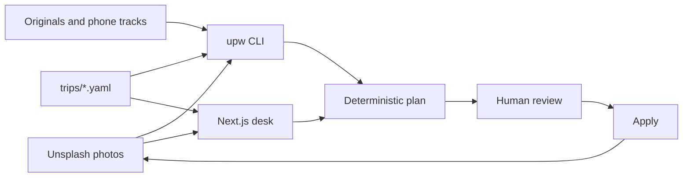
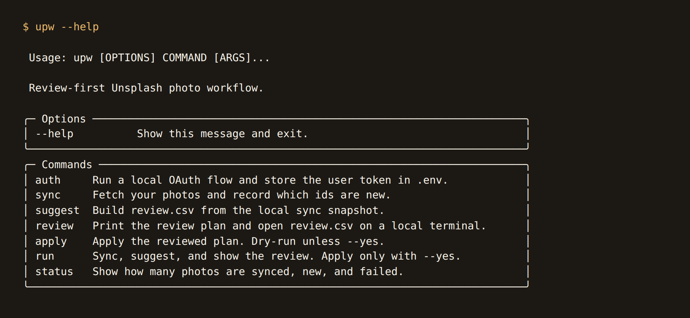
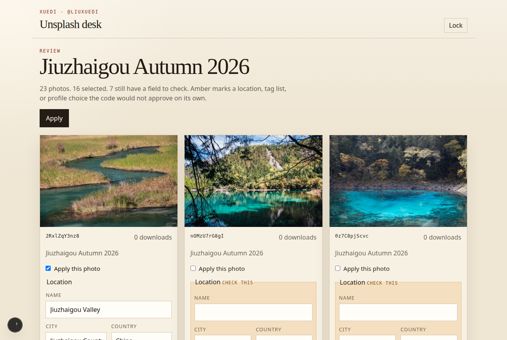
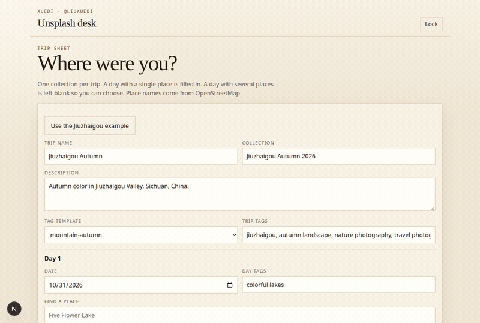

# unsplash-photo-workflow

[](https://github.com/Xuedixuedi/unsplash-photo-workflow/actions/workflows/ci.yml)
[](https://www.python.org/)
[](https://docs.astral.sh/ruff/)
[](LICENSE)
[](web/)
[](#deploy-on-vercel)

Built for and used on [my Unsplash portfolio](https://unsplash.com/@liuxuedi).

Many DSLR and mirrorless cameras do not record GPS, and the Unsplash API does not return it from EXIF. After each upload batch, this project fills a location, tags (up to 20), a description, one collection per trip, and a show-on-profile suggestion. Deterministic code does the work. An LLM is called only for the slots that code cannot fill, and nothing is written until a human approves the plan.

[](https://unsplash.com/photos/natural-stone-arch-in-nusa-penida-nUhiZ0AVIAk)

*Photo by [Xuedi](https://unsplash.com/@liuxuedi) on Unsplash · [Natural stone arch, Nusa Penida, Bali](https://unsplash.com/photos/natural-stone-arch-in-nusa-penida-nUhiZ0AVIAk)*

## Features

- 📍 A location chain that stops at the first real hit: file GPS, a phone track, the trip itinerary, a neighbour, then an optional model
- 🏷️ Tags filled toward 20, keeping the ones already on the photo and refusing brands and hashtags
- 📝 A description kept when one exists, otherwise a sentence built from the place
- 🗂️ One collection per trip, created on apply when the title is missing
- 👁️ Profile visibility that never hides a photo with more than 100 downloads
- ✋ A review file, or a web grid, before any write
- 🤖 `--no-ai` turns the model off for the whole run
- 🔁 Apply is a dry run until `--yes`, and a second apply skips fields that already match

## From the portfolio

| | | |
| --- | --- | --- |
| [](https://unsplash.com/photos/nDWk_RXVtO4) | [](https://unsplash.com/photos/turquoise-waves-crashing-against-rocky-cliff-Jn64I7LFr14) | [](https://unsplash.com/photos/a-large-ship-sails-on-a-dark-lake-near-mountains-hH_bEgCLtE4) |
| [Jiuzhaigou, China](https://unsplash.com/photos/nDWk_RXVtO4) | [Nusa Penida, Bali](https://unsplash.com/photos/turquoise-waves-crashing-against-rocky-cliff-Jn64I7LFr14) | [Lake Ashi, Hakone, Japan](https://unsplash.com/photos/a-large-ship-sails-on-a-dark-lake-near-mountains-hH_bEgCLtE4) |

Photos by [Xuedi](https://unsplash.com/@liuxuedi) on Unsplash. The image URLs are the public `images.unsplash.com` files already stored in `fixtures/photos.json`.

## Quickstart

```bash
python -m pip install -e ".[dev]"
cp .env.example .env
upw auth
upw run          # sync, suggest, print the review, stop
# edit state/review.csv
upw apply --yes  # write the rows whose approve column is yes
```

The desk is the same plan in a browser. From `web/`, copy the keys into `.env.local`, then:

```bash
cd web
npm ci
npm run dev
```

Open http://localhost:3000, sign in, fill the trip (or use the Jiuzhaigou example), press **Start analysis**, edit the amber fields, and press **Apply**.

## How it works



1. **Sync** downloads the public library and remembers which ids are not processed yet.
2. **Suggest** builds a plan: location, tags, description, collection, and show-on-profile, each with a confidence and a flag.
3. **Review** is `state/review.csv` on the command line, or the photo grid in the desk. Amber, and the `no` rows, are the fields to check.
4. **Apply** writes only what was approved. The default is a dry run.







`approve` values:

| value | meaning |
| --- | --- |
| `yes` | apply the proposed location, tags, description, visibility, and collection |
| `no` | leave the photo alone this time; it stays in the next plan |
| `skip` | ignore the photo on later runs |

Rows the pipeline is confident about start as `yes`. A neighbour guess, an LLM suggestion, a burst hide, or an empty location starts as `no`. Low-confidence fields are flagged in their own columns (`location_flag`, `tags_flag`, and so on).

## Location chain

The first hit wins:

1. GPS in the local original file (`originals/{photo_id}.jpg`, or a row in `originals/manifest.csv`).
2. A phone photo, GPX track, or Google Timeline JSON (`UPW_PHONE_SOURCE`), matched by time. `camera_clock_offset_seconds` in `config/rules.yaml` is added to the camera clock first. The timestamp is read as `timezone` (default `Asia/Shanghai`).
3. The trip itinerary, when that calendar day lists exactly one place.
4. A neighbouring photo in the same batch, within `neighbour_max_seconds`, when both have a real clock time.
5. The optional LLM, which may choose only among the itinerary places for that day.
6. Otherwise the location stays empty and the row is flagged for review.

A location already stored on the photo is kept when local GPS does not contradict it, so a re-run does not churn a place you already set. Without a local original, the itinerary is matched on the Unsplash upload date, because the API does not provide the shutter time.

## Tags, description, collections, visibility

Tags keep the ones already on the photo (lowercased, case-insensitive dedupe). Then the pipeline adds the place, city, region, and country, the trip's tags, and the tags from the trip's template in `config/tag_templates.yaml`. New tags are lowercase, 1–3 words, and never a camera brand or a hashtag. Existing tags may be up to 5 words so phrases such as "unesco world heritage site" survive. Only the slots left under 20 are offered to the LLM, and only when a small image of the original is available.

The description is kept when one already exists. Otherwise it is a sentence built from the place. The LLM writes one only when that template has nothing to say.

Photos are grouped by the trip whose dates cover the capture day. Unmatched photos are clustered when consecutive dates are more than `cluster_gap_days` apart. The collection is created on apply if the title does not exist yet. Adding a photo that is already in the collection is a no-op on Unsplash.

`show_on_profile` is proposed `false` for extra frames in a burst shorter than `burst_seconds`. A photo with more downloads than `never_hide_above_downloads` (100) is never hidden. Hiding is always flagged for review, so it is not auto-approved.

## Project layout

```
src/upw/adapters/   Unsplash, Nominatim, EXIF/GPX, optional LLM
src/upw/core/       sync, locate, tag, group, rules, plan, apply
config/             rules.yaml and tag_templates.yaml
trips/*.yaml        one itinerary per trip
fixtures/           trimmed public metadata for tests
state/              gitignored caches, processed ids, logs, review files
web/                Next.js review desk
```

`trips/example-jiuzhaigou.yaml` is a real-shaped example: trip name, collection name, a day, and two places. Copy it and edit the dates. A day with one place is filled in directly. Several places are left blank unless a neighbour or the LLM can choose.

## Create the Unsplash app

1. Open [unsplash.com/oauth/applications](https://unsplash.com/oauth/applications) and create an application.
2. Set the redirect URI to `http://127.0.0.1:8787/callback`.
3. Request scopes `public`, `read_user`, `write_photos`, and `write_collections`.
4. Copy the access key and secret key into `.env` (see `.env.example`). Never commit `.env`.

Demo apps are limited to 50 requests per hour. Production apps are limited to 1000. The client reads `X-Ratelimit-Limit` and `X-Ratelimit-Remaining`. It sleeps for `Retry-After` or until `X-Ratelimit-Reset` when that wait is short, and otherwise stops with a resume time so you can run the command again. There is no upload endpoint and no photo-delete endpoint. Those are out of scope.

```bash
upw auth
```

This opens the Unsplash consent page, catches the redirect on localhost, and writes `UNSPLASH_USER_TOKEN` into `.env`. The token is not printed. JSON logs redact bearer tokens and known secret values.

## Optional LLM

Leave `LLM_API_KEY` empty, or pass `--no-ai`, and the pipeline stays deterministic. When a key is set, calls go to an OpenAI-compatible `LLM_BASE_URL` (`/chat/completions`, JSON object responses) with a JPEG no larger than 512px. Responses are cached by photo id plus a hash of the prompt and image. Another provider can implement `JsonCompleter` in `src/upw/adapters/llm.py`.

Nominatim is limited to one request per second, sends `NOMINATIM_USER_AGENT`, and caches results in `state/cache/geocode.json`.

## Commands

```text
upw auth
upw sync
upw suggest [--no-ai] [--all]
upw review
upw apply [--yes] [--only-failed]
upw run [--no-ai] [--all] [--yes]
upw status [--format json]
```

`--all` plans photos that were already processed. `--only-failed` retries photos that failed in the last apply. Each command writes `state/logs/{run_id}.json` with a run id, the events, and the failed items, and prints a short summary at the end.

Originals and phone tracks:

```text
originals/2RxlZqY3nz8.jpg
originals/manifest.csv          # photo_id,file
UPW_PHONE_SOURCE=phone/track.gpx
UPW_PHONE_SOURCE=phone/timeline.json
UPW_PHONE_SOURCE=phone/exports/
```

Google Timeline JSON accepts `locations[].latitudeE7` / `longitudeE7` with `timestamp` or `timestampMs`, or a list of `{time, lat, lon}`.

## Tests

HTTP is mocked. No live Unsplash or LLM credentials are required.

```bash
ruff check . && ruff format --check .
mypy src
pytest --cov=upw --cov-report=term-missing --cov-fail-under=80
```

CI on every pull request and on `master` runs those checks, the web lint, typecheck, test, and build, plus gitleaks. This repository is public. Do not commit tokens, `.env`, or `state/`.

`fixtures/photos.json` and `fixtures/tags_current.json` are trimmed from public photo metadata and current tags. They are safe to commit. Camera make and model are omitted from the fixture text.

## GitHub Actions

`.github/workflows/unsplash-run.yml` (workflow name **Unsplash run**) plans photos on a runner. It does not replace a local review when you want to edit a row.

Secrets go under Settings → Secrets and variables → Actions → Secrets. The job never prints their values. If any of the first three is empty, the job exits 0 and writes this to the log and the step summary:

```text
Unsplash run skipped: missing <names>. Add UNSPLASH_ACCESS_KEY, UNSPLASH_SECRET_KEY, and UNSPLASH_USER_TOKEN under Settings → Secrets and variables → Actions.
```

| Secret | Required | Role |
| --- | --- | --- |
| `UNSPLASH_ACCESS_KEY` | yes | Application access key |
| `UNSPLASH_SECRET_KEY` | yes | Application secret. The run itself calls the API with the user token. |
| `UNSPLASH_USER_TOKEN` | yes | User token from `upw auth` on your machine. Paste the value; do not commit it. |
| `LLM_API_KEY` | no | When this is empty the run adds `--no-ai` and says so. |

Optional variables (same settings page, Variables tab):

| Variable | Role |
| --- | --- |
| `ENABLE_UNSPLASH_SCHEDULE` | Set to exactly `true` to let the daily job do work. Any other value, including unset, skips it. |
| `UNSPLASH_USERNAME` | Defaults to `liuxuedi` when unset. |
| `LLM_BASE_URL` | Defaults to `https://api.openai.com/v1`. |
| `LLM_MODEL` | Defaults to `gpt-4o-mini`. |

Manual run: Actions → Unsplash run → Run workflow.

| Input | Default | Effect |
| --- | --- | --- |
| Apply writes | off | On passes `--yes`. That writes every row the planner already marked `yes` in the same run. There is no pause to edit the CSV on the runner. |
| Skip AI | on | Passes `--no-ai`. An empty `LLM_API_KEY` forces `--no-ai` even if you turn this off. |
| Plan already processed photos | off | Passes `--all`. |

The daily cron is `0 16 * * *` (16:00 UTC, 00:00 Asia/Shanghai). The job starts, and unless `ENABLE_UNSPLASH_SCHEDULE` is `true` it exits 0 with: `Unsplash daily run skipped: set the repository variable ENABLE_UNSPLASH_SCHEDULE to true ... The schedule never applies changes.` When the variable is `true`, the job syncs. If `upw status --format json` reports `new` of 0, it exits 0 with `Unsplash daily run skipped: sync found no new photos. Nothing was suggested or applied.` Otherwise it runs `upw suggest` and still does not pass `--yes`.

Runners have no `state/` directory of their own. The workflow restores and saves `state/` with `actions/cache` (`upw-state-<run id>`, restoring the newest `upw-state-` cache). `.env` is written with mode `0600` for that job only. It is not cached and not uploaded. The first run after an empty cache plans the whole library, because nothing is processed yet. GitHub can evict a cache that has not been used for a while; the next run plans again. A later `--yes` still skips fields that already match the live photo.

Artifacts are uploaded as `upw-review-<run id>`: `state/review.csv`, `state/review.json`, and `state/logs/`. A skipped secret check does not upload anything. Download the CSV, edit it locally, put it in your local `state/`, and run `upw apply --yes` on your machine when a row needs a human change. Rows marked `no` are not written by `--yes`.

## Web desk

`web/` is a Next.js app for the same review, aimed at Vercel. It is a TypeScript port of the deterministic plan and apply path, so the site is one Next.js project. The Python package remains the source of truth for `upw`, GitHub Actions, file GPS, phone tracks, and the optional model. The web tests read `fixtures/photos.json`, `config/rules.yaml`, `config/tag_templates.yaml`, and `trips/example-jiuzhaigou.yaml`, and fail if the embedded copies drift.

The desk asks for a password (`UPW_PASSWORD`) and stores an HMAC session cookie signed with `UPW_SESSION_SECRET`. Locally it stores plans in SQLite (`web/data/upw.sqlite`, or `UPW_SQLITE_PATH`). On Vercel set `DATABASE_URL` to a Neon Postgres connection string. Without that variable the app refuses to boot on Vercel, because the serverless disk is not a database. `SENTRY_DSN`, when set, sends exception events to that DSN. The Next config is not wrapped by a Sentry plugin, and a missing DSN does nothing.

`UPW_USE_FIXTURES=1` reads the committed public metadata and never calls Unsplash. Leave it unset in production.

```bash
cd web
npm ci
npm test
npm run build
```

Copy the keys into `web/.env.local` (Next does not read the repo-root `.env` into Middleware):

```bash
UPW_PASSWORD=choose-a-long-password
UPW_SESSION_SECRET=choose-another-long-secret
UNSPLASH_ACCESS_KEY=
UNSPLASH_SECRET_KEY=
UNSPLASH_USER_TOKEN=
UNSPLASH_USERNAME=liuxuedi
NOMINATIM_USER_AGENT=unsplash-photo-workflow/0.1 (https://github.com/Xuedixuedi/unsplash-photo-workflow)
# DATABASE_URL=postgres://...
# SENTRY_DSN=https://...
# UPW_USE_FIXTURES=1
```

Then `npm run dev` and open http://localhost:3000. Sign in, fill the trip (or use the Jiuzhaigou example), press **Start analysis**, edit the amber fields, and press **Apply**. Apply writes one selected photo at a time and lists failures without stopping the rest. Fixture mode shows that Unsplash was not called.

### Deploy on Vercel

This repository is not deployed from here. You create the project.

1. In the Vercel dashboard, import `Xuedixuedi/unsplash-photo-workflow`.
2. Set the root directory to `web`. Framework preset: Next.js. Node.js version: 22.
3. Create a Neon database (Vercel Marketplace or [neon.tech](https://neon.tech)) and copy its pooled connection string.
4. Set the environment variables for Production (and Preview, if you want the preview to work):

| Name | Required | Value |
| --- | --- | --- |
| `UPW_PASSWORD` | yes | A password only you know |
| `UPW_SESSION_SECRET` | yes | A long random string. Changing it signs everyone out. |
| `DATABASE_URL` | yes | Neon Postgres connection string |
| `UNSPLASH_ACCESS_KEY` | yes | Same access key as the Unsplash app |
| `UNSPLASH_SECRET_KEY` | yes | Same secret key |
| `UNSPLASH_USER_TOKEN` | yes | The token from `upw auth` |
| `UNSPLASH_USERNAME` | no | `liuxuedi` if unset |
| `NOMINATIM_USER_AGENT` | yes | Identify this app, including a way to contact you |
| `SENTRY_DSN` | no | Leave empty to disable error reporting |
| `LLM_API_KEY` | no | Unused by the desk. The CLI and Actions use it. |

5. Do not set `UPW_USE_FIXTURES` on Vercel.
6. Deploy. The first screen is the password form. Analysis reads your public photos, builds the plan, and stores it in Neon. Apply calls `PUT /photos/:id` and the collection endpoints with your user token.

Place search calls Nominatim from the server, one request per second, with the User-Agent above. A day with two places stays empty until you fill it. The desk cannot see file GPS or shutter time, so it does not hide burst frames. Use the profile checkbox yourself, or run `upw` locally when the originals are on disk. Photos with more than 100 downloads are still kept on the profile.

Branch protection on `master` should require a pull request and the status checks named `python`, `gitleaks`, and `web`. The API token used while building this repo could not set that rule (GitHub returned 403). Settings → Branches → Add rule for `master`. Leave approving reviews off if a green CI run should be enough to merge.

Set the description and topics under Settings → General. The API token returned 403, so they are still unset. Description: "Review-first workflow that fills Unsplash locations, tags, descriptions, and trip collections, then waits for a human before it writes." Topics: `unsplash`, `photography`, `automation`, `python`, `nextjs`, `cli`, `github-actions`.

## Limitations

- Many DSLR and mirrorless cameras do not record GPS. Unsplash does not return GPS, and it does not return the shutter time. Capture time comes from local originals.
- The public API lists public photos only. There is no upload and no delete.
- Demo apps share a 50 request hourly budget. `upw run` on a large library can spend that on sync alone. Apply compares against the last sync snapshot and updates the snapshot after a successful write.
- Hiding a weaker shot, without an aesthetic model, means a burst extra, plus any ids listed in `force_hide_ids`. Downloads above 100 are never hidden. The web desk cannot see shutter times, so burst hiding stays on the CLI.
- The Actions cache and the laptop `state/` directory are separate. A reviewed CSV from one applies on the other after you copy it.
- The web desk and `upw` do not share a database. Apply from one does not mark the other's processed ids. A second apply still skips fields that already match.
- Nominatim is a public service. Keep the User-Agent honest and the cache on.
